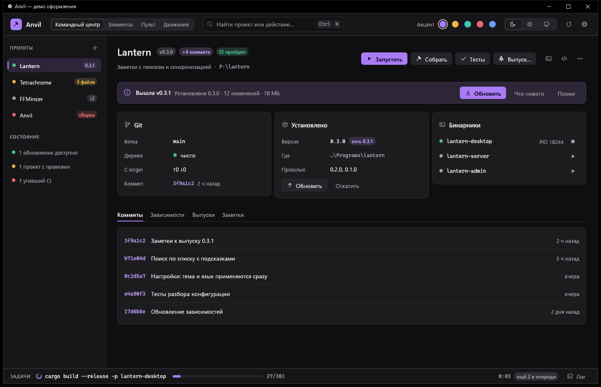
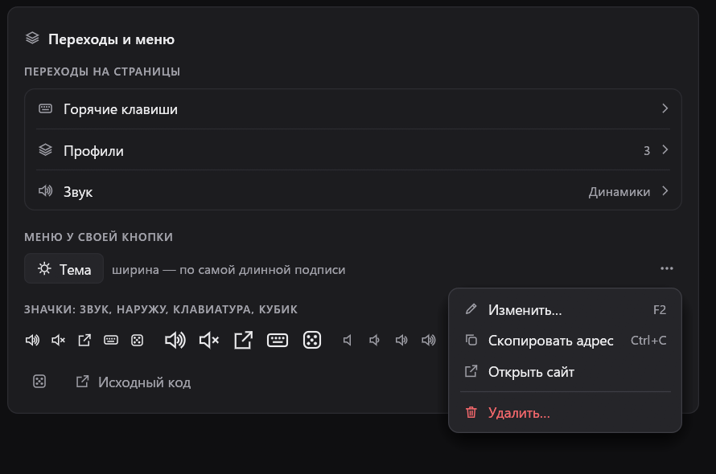
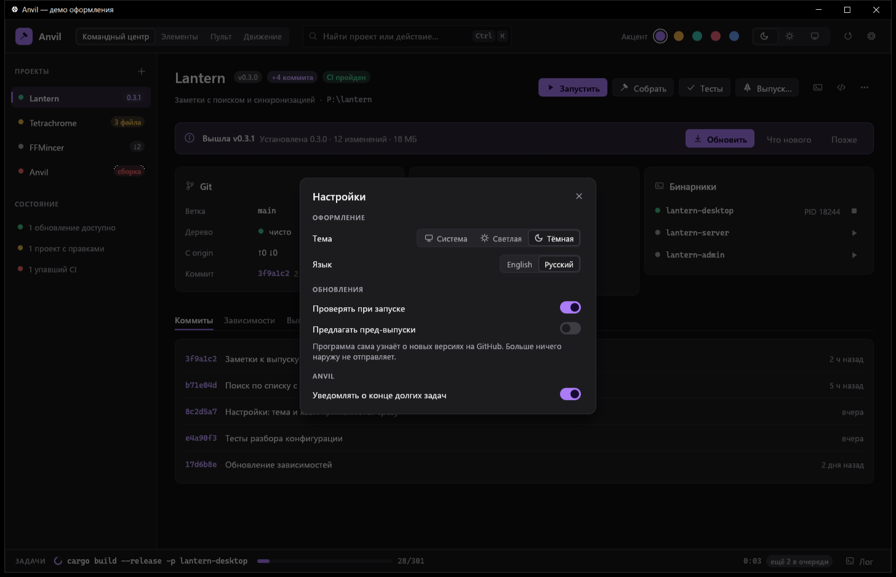

# Внешний вид программ семьи Anvil

Руководство для всех программ, собранных на `anvil-ui`: Anvil, Tetrachrome, FFMincer, Kamerton, Antresol
и новых.
Здесь — правила и значения; код — в `crates/anvil-ui`, живой пример — витрина:

```sh
cargo run -p anvil-ui --example gallery --features demo
```

Код витрины — модуль `anvil_ui::demo` (feature `demo`, по умолчанию выключена); в Anvil она открывается
отдельным окном: «Меню» → «Демо оформления…» или палитра `Ctrl+K`.

Значения в этом файле совпадают с кодом на момент 23.10.2026 (набор 0.8.0). Если они разошлись, прав код, а
файл нужно поправить.



---

## 1. Принципы

1. **Инструмент, а не витрина.** Серые поверхности без оттенка, один цвет-акцент, мало украшений.
   Внимание достаётся данным и действиям, а не рамкам.
2. **Семья узнаётся по устройству, программа — по цвету.** Раскладка окна, шрифты, кнопки и
   отступы у всех одинаковые, а акцент у каждой программы свой.
3. **Цвет что-то значит.** Зелёный — хорошо, жёлтый — требует внимания, красный — сломано или
   необратимо, акцент — «сюда, это главное». Цвет не используют для красоты.
4. **Всё читается.** Любой текст держит контраст не меньше 4.5:1 к своему фону, в обеих темах и
   со всеми акцентами. Это проверяет тест, а не глаз.
5. **С клавиатуры — тоже.** Фокус виден, у каждой кнопки есть имя для диктора.
6. **Движение — служба, не украшение.** Короткие переходы 90–300 мс, один яркий момент на экран,
   бесконечное движение только пока идёт процесс, «Показывать анимацию» в Windows выключено — всё
   мгновенно. Шкала, кривые и готовые эффекты — [MOTION.md](MOTION.md).
7. **Ничего не ломается молча.** Ошибка всегда видна: баннером, уведомлением или строкой в задачах.
   Необратимое делается только после подтверждения, где написано, что именно произойдёт.

---

## 2. Цвет

### 2.1. Токены

В коде цвета не пишутся числами: только `Palette::of(ui)` и её поля. Тогда смена темы и акцента
подхватывается сама.

| Токен | Тёмная | Светлая | Для чего |
|---|---|---|---|
| `bg` | `#0F0F11` | `#F3F3F4` | фон основной области окна |
| `surface` | `#161618` | `#FAFAFA` | шапка, боковая панель, строка состояния |
| `card` | `#1C1C1F` | `#FFFFFF` | карточки, диалоги, уведомления |
| `raised` | `#252529` | `#F0F0F2` | кнопки, дорожки, подложки значков |
| `hover` | `#2B2B30` | `#E8E8EB` | подсветка под курсором |
| `border` | `#2C2C31` | `#E2E2E5` | рамки карточек, разделители |
| `border_strong` | `#3D3D44` | `#CBCBD0` | рамка под курсором, выбранный сегмент |
| `field` | `#121214` | `#FFFFFF` | фон полей ввода |
| `popup` | `#252529` | `#F0F0F2` | всплывающий слой: меню, выпадающий список |
| `popup_hover` | `#323238` | `#DCDCDF` | пункт меню и списка под курсором |
| `text` | `#ECECEE` | `#17171A` | основной текст |
| `weak` | `#A0A0A8` | `#55555D` | подписи, пояснения, неактивные значки |
| `faint` | `#6E6E76` | `#8A8A92` | плейсхолдеры, недоступное; **не для важного текста** |
| `success` | `#4CC38A` | `#16703F` | готово, пройдено, запущено |
| `warning` | `#E5B54A` | `#8F5F00` | есть правки, ломающее обновление, внимание |
| `danger` | `#F2676B` | `#C4303A` | упало, уязвимость, удаление |

Слои от нижнего к верхнему: `bg` → `surface` / `card` → `raised` / `popup` → `hover` / `popup_hover`. Каждый
следующий слой светлее в тёмной теме и темнее или белее в светлой. Тени — только у всплывающего: диалогов, меню и
уведомлений.

**Всплывающий слой** — на ступень выше `card`: меню лежит над карточкой или диалогом, и с фоном `card` оно
сливалось с ними (в тёмной теме `#1C1C1F` на `#1C1C1F`, в светлой белое на белом). Рамка — `border_strong`,
разделитель внутри — тоже `border_strong` (`border` на `popup` почти не виден). Тень всплывающего —
`p.popup_shadow()`: сдвиг вниз 8, размытие 24, чёрный 200/255 в тёмной теме и 70/255 в светлой; она же
`popup_shadow` стиля egui (подсказки, уведомления). У диалогов тень своя, глубже — `window_shadow`: сдвиг 12,
размытие 36, чёрный 140/255 и 45/255. Тест `the_popup_layer_stands_out` следит, что меню непрозрачно, не
совпадает с `card` и `bg`, тень не слабее 70/255 и размытия 20, а подсветка пункта и разделитель на нём заметнее
`hover` и `border`.

**Мягкая подложка** `p.soft(цвет)`: цвет с прозрачностью 16 % в тёмной теме и 12 % в светлой. Из неё
делаются выбранный пункт боковой панели и баннеры. Текст на мягкой подложке — тем же цветом, что и
подложка, но полной силы.

**Непрозрачная подложка** `p.badge_fill(цвет)` — мягкая, заранее положенная на `card`. Из неё бейджи
и опасная кнопка: так их контраст не зависит от того, на чём они лежат (выбранная строка `raised`,
панель `surface`). Полупрозрачный бейдж на `raised` в светлой теме падал ниже 4.5:1.

### 2.2. Акцент программы

У акцента три значения на каждую тему:
- `accent` — заливка главной кнопки, полосы прогресса, включённого переключателя;
- `on_accent` — текст и значки поверх заливки;
- `accent_text` — акцентный текст на обычном фоне: ссылки, хеши, выбранная вкладка.

| Акцент | Программа | Тёмная: заливка / на ней / текст | Светлая: заливка / на ней / текст |
|---|---|---|---|
| `VIOLET` | Anvil | `#AB7CF6` / `#150A31` / `#BF9FFB` | `#7439D9` / `#FFFFFF` / `#6229C4` |
| `AMBER` | — | `#F2B54A` / `#1C1403` / `#F2B54A` | `#F2B54A` / `#1C1403` / `#8A5A00` |
| `TEAL` | Tetrachrome | `#3CC8B4` / `#04201C` / `#4FD6C3` | `#0E7C70` / `#FFFFFF` / `#0B6E63` |
| `ROSE` | FFMincer | `#F0647A` / `#22060B` / `#F4808F` | `#C22D48` / `#FFFFFF` / `#B3263F` |
| `BLUE` | Kamerton и программы без своего цвета | `#6C9EF8` / `#06142E` / `#86B0FA` | `#2A5FD0` / `#FFFFFF` / `#2556C0` |

Правила акцента:
- На экране **одна** главная кнопка, залитая акцентом. Остальные — обычные или тихие.
- Акцентом отмечают выбранное и главное, а не всё подряд. Если акцента на экране много, он
  перестаёт что-то значить.
- Новая программа сначала берёт `BLUE`. Свой акцент заводится в `Accent`, получает строки в тесте
  контраста и строку в этой таблице.
- Оттенок нового акцента берут на свободном участке круга оттенков: занятые — AMBER 38°, TEAL 171°, BLUE 219°,
  ROSE 351°, статусы — успех 151°, внимание 41°, ошибка 356°. Красный и оранжевый рядом с ними путаются со
  статусами и с `AMBER`; свободно 230–340° (у Anvil — `VIOLET`, 263°).

### 2.3. Смысловые цвета (`Tone`)

| `Tone` | Цвет | Когда |
|---|---|---|
| `Neutral` | `weak` | версия, счётчик, «актуально», «без CI» |
| `Accent` | `accent_text` | новое, «+4 коммита», доступное обновление |
| `Success` | `success` | CI пройден, чисто, запущено, готово |
| `Warning` | `warning` | есть правки, ломающее обновление, отстаёт от origin |
| `Danger` | `danger` | CI упал, уязвимость, ошибка сборки |

Цвет никогда не бывает единственным носителем смысла: рядом всегда есть текст («CI упал») или значок.

### 2.4. Тёмная и светлая темы

По умолчанию тема берётся из системы и переключается вслед за ней. Пользователь может закрепить
светлую или тёмную в «Настройках». Фон, которым eframe чистит окно, — `chrome::clear_color`, иначе
при изменении размера мелькает чужой цвет.

**Подмена палитры (с набора 0.9.0).** Программа может заменить таблицу набора целиком — например, цветами системы при
высоком контрасте Windows: `theme::set_palette_override(ctx, Some(палитра))`, снять — `None`; что подменено сейчас —
`theme::palette_override(ctx)`. Пока подмена задана, её берут `Palette::of`/`of_ctx`, значит и все виджеты набора, а
стиль egui пересобирается из неё (основа тёмная или светлая — по `Palette::dark`). Окно чистится цветом
`chrome::clear_color_of(ctx)`. Подмена не зависит от темы: выбор темы (`choose`) её не снимает, тему программа ставит
сама по `Palette::dark`. Читать цвета системы и собирать из них палитру — дело программы (набор ничего не знает о
Windows); читаемость чужой палитры — забота того, кто её подаёт: тест контраста относится к таблице набора.

---

## 3. Текст

### 3.1. Шрифты

| Роль | Шрифт | Запасной |
|---|---|---|
| интерфейс | Segoe UI | встроенный шрифт egui |
| полужирный | Segoe UI Semibold (`semibold(размер)`) | Segoe UI Bold |
| моноширинный | Cascadia Mono | Consolas |

На Linux — Noto Sans и DejaVu Sans Mono, если они есть. За системным шрифтом всегда стоят
встроенные шрифты egui: в них есть символы, которых в системном может не оказаться.

### 3.2. Шкала

| Роль | Размер | Начертание | Цвет | Где в коде |
|---|---|---|---|---|
| заголовок экрана | 24 | полужирный | `text` | `RichText::font(semibold(24.0))` |
| заголовок диалога | 17 | полужирный | `text` | `chrome::dialog` |
| заголовок карточки | 14.5 | полужирный | `text` | `widgets::card_title` |
| основной текст, кнопки | 14 | обычный | `text` | стиль `Body`, `Button` |
| пояснение | 13 | обычный | `weak` | `widgets::note` |
| моноширинный: хеш, путь, версия, команда | 12.5 | моно | `weak` или `text` | `widgets::mono` |
| мелкое | 12 | обычный | `weak` | стиль `Small` |
| подпись раздела | 11, ЗАГЛАВНЫМИ, разрядка 0.8 | полужирный | `weak` | `widgets::section_label` |

Полужирный — для заголовков, главной кнопки, бейджей и выбранного пункта. В основном тексте
полужирный не используется.

### 3.3. Как писать

- Коротко и по делу: «Собрать», «Обновить», «Выпуск…». Многоточие ставится, если кнопка открывает
  окно и действие ещё можно отменить.
- С заглавной только первое слово: «Проверять при запуске», а не «Проверять При Запуске».
- В подтверждении пишется, **что именно произойдёт**: команды, версия, ветка. Кнопка называется
  действием («Выпустить», «Удалить»), а не «OK».
- Ошибка говорит, что сломалось и что делать дальше: «clippy: 2 ошибки · Лог», а не «Ошибка».
- Технические вещи — хеши, пути, команды, версии — пишутся моноширинным.
- Строки самого набора переводятся через `tr(ctx, "…")` (русский ключ, английский перевод в
  `lang.rs`). Строки программы переводит программа.

---

## 4. Размеры и отступы

### 4.1. Скругления (`theme::radius`)

| Имя | Значение | Что |
|---|---|---|
| `SMALL` | 4 | клавиши, мелкие детали |
| `CONTROL` | 6 | кнопки, поля, сегменты, строки списка, пункты меню |
| `CARD` | 10 | карточки, баннеры, меню, уведомления |
| `WINDOW` | 12 | диалоги |
| — | половина высоты | бейджи и переключатели: пилюли |

### 4.2. Высоты

| Что | Высота |
|---|---|
| шапка (`chrome::TOP_BAR`) | 56 |
| строка состояния (`chrome::STATUS_BAR`) | 38 |
| строка навигации | 34 |
| кнопка, кнопка-значок, сегменты, пункт меню, выпадающий выбор | 30 |
| сегмент столбиком (`segmented_full`, подписи не помещаются) | 26 |
| строка-переход (`nav_rows`) | 40 |
| ползунок (дорожка 4, ручка 14, под курсором 16) | 24 |
| вкладки | 32 |
| бейдж | 20 |
| клавиша | 19 |
| дорожка переключателя | 20 (ширина 34) |
| полоса прогресса | 6 |

### 4.3. Отступы

| Где | Значение |
|---|---|
| основная область (`chrome::content`) | 28 по бокам, 22 сверху и снизу |
| боковая панель (`chrome::side_panel`) | 10 по бокам, 14 сверху и снизу; ширина 260 |
| шапка и строка состояния | 16 по бокам |
| внутри карточки | 16 |
| внутри баннера и уведомления | 14 × 10 |
| внутри диалога | 20 (подтверждение); 20 / 12 / 14 / 18 (обычный диалог) |
| между элементами | 8 по горизонтали, 6 по вертикали |
| между карточками | 12–14 |
| между разделами экрана | 18 |

Размеры кратны 2, крупные — 4. Новых «почти таких же» значений не заводим: берём ближайшее из таблиц.

---

## 5. Значки

- Рисуются кодом, линиями, в сетке 24 × 24 (`icons::paint`). Толщина линии — 1.7 от сетки, но не
  тоньше 1.2 px.
- Размеры: 16 — в кнопках, меню, строках; 17 — в кнопке-значке; 18 — в баннере; 22 — в пустом
  состоянии.
- Цвет — как у текста рядом: `weak` в покое, `text` под курсором, `on_accent` на акценте, цвет `Tone`
  в баннерах и уведомлениях.
- Картинки и шрифты-иконки не используем: они выглядят по-разному на разных системах.

Набор (`Icon::ALL`, 58): `ArrowDown`, `ArrowLeft`, `ArrowRight`, `ArrowUp`, `Bot`, `Branch`, `Broadcast`, `Chat`,
`Check`, `ChevronUp`, `Clock`, `Close`, `Code`, `Copy`, `Cube`, `Dice`, `Download`, `Expand`, `External`, `File`, `Film`,
`Folder`, `Gamepad`, `Gear`, `Hammer`, `Hive`, `Image`, `Info`, `Keyboard`, `Layers`, `Lock`, `Minus`, `Moon`, `More`,
`Monitor`, `Package`, `Pause`, `Pencil`, `Pin`, `Play`, `Plus`, `Redo`, `Refresh`, `Rocket`, `Save`, `Search`, `Server`,
`Speaker`, `SpeakerMuted`, `Stop`, `Sun`, `Target`, `Terminal`, `Tiles`, `Trash`, `Undo`, `Warning`, `Window`.

`ArrowDown` — галочка вниз (раскрыть, ниже), `ChevronUp` — её пара вверх; `ArrowUp` — стрелка со
стержнем (есть новее, обновить).

- `Speaker` — динамик с тремя волнами (звук, громкость), `SpeakerMuted` — с крестом вместо волн (без звука).
  Волны по уровню громкости — `icons::speaker(painter, rect, цвет, уровень, без_звука)`: 0 — ни одной, до 0.33 —
  одна, до 0.66 — две, громче — три.
- `External` — рамка со стрелкой из угла: у ссылки, которая открывает другое окно, программу или сайт.
- `Keyboard` — клавиатура: вход на страницу сочетаний клавиш.
- `Dice` — игральный кубик (грань «пять»): случайное значение, «случайный seed».

Новый значок рисуется в той же сетке и той же толщиной и появляется в витрине. Проверять его
нужно в размере 16: если он там не читается, значок упрощают.

---

## 6. Раскладка окна

```
┌─────────────────────────────────────────────────────────────┐
│ ▣ Имя   [разделы]   [ поиск Ctrl K ]        переключатели ⚙ │  шапка 56, surface
├──────────────┬──────────────────────────────────────────────┤
│ ПОДПИСЬ      │  Заголовок  бейджи            [Главная] [..] │
│ ● пункт      │  пояснение                                    │
│ ● пункт      │  ┌ баннер ─────────────────────────────────┐ │
│              │  └─────────────────────────────────────────┘ │
│ боковая      │  ┌ карточка ┐ ┌ карточка ┐ ┌ карточка ┐      │  основная область, bg
│ панель 260,  │  └──────────┘ └──────────┘ └──────────┘      │
│ surface      │  Вкладка · Вкладка · Вкладка                 │
│              │  ┌ карточка на всю ширину ─────────────────┐ │
├──────────────┴──────────────────────────────────────────────┤
│ ЗАДАЧИ ◌ команда ▓▓▓░░ 214/301                    ещё 2  Лог │  строка состояния 38, surface
└─────────────────────────────────────────────────────────────┘
```

- **Шапка** (`chrome::top_bar`): слева знак и название (`chrome::brand`), потом переключатель
  разделов и поиск, справа — глобальные переключатели и меню ⚙ с «Настройками» и «О программе».
- **Боковая панель** (`chrome::side_panel`) — если есть список, по которому ходят: проекты,
  пресеты, беседы. Если списка нет, панели нет.
- **Основная область** (`chrome::content`) — прокручивается. Порядок сверху вниз: заголовок с
  действиями справа, баннер (если есть), карточки, вкладки с подробностями.
- **Строка состояния** (`chrome::status_bar`) — долгие задачи, ход, короткие подсказки. Она не
  прыгает по высоте и не прячется.
- **Знак программы** (`chrome::app_mark`) — квадрат акцента со значком программы, скругление —
  четверть стороны. В шапке он 28, в «О программе» — 56. Тот же знак — значок окна и exe
  (`appicon::icon_data`, `appicon::rgba` в `build.rs`). Исключение — Anvil: его значок окна, exe, трея и
  уведомлений — готовые PNG (`crates/anvil/assets/icon`, соты с фиолетовым ядром), а в интерфейсе знак Anvil —
  квадрат `VIOLET` со значком `Hive`.

| Программа | Акцент | Значок знака |
|---|---|---|
| Anvil | `VIOLET` | `Hive` |
| Tetrachrome | `TEAL` | `Tiles` |
| FFMincer | `ROSE` | `Film` |

---

## 7. Компоненты

Всё ниже есть в витрине на вкладке «Элементы».


### Кнопки — `widgets::button(ui, Kind, значок, текст)`

| `Kind` | Вид | Когда |
|---|---|---|
| `Primary` | заливка акцентом, полужирный | главное действие экрана. **Одна на экран** |
| `Secondary` | `raised` с рамкой | обычные действия: «Собрать», «Тесты» |
| `Ghost` | без фона до наведения, текст `weak` | второстепенное: «Позже», «Лог», «Откатить» |
| `Danger` | непрозрачный мягкий красный, рамка красным наполовину, красный текст; под курсором темнеет рамка, а не заливка | необратимое. Всегда ведёт к подтверждению |

- Значок слева от текста — если он помогает узнать действие с первого взгляда.
- Недоступная кнопка любого вида выглядит одинаково: плоская, текст `faint`.
- Кнопки в ряду идут так: главная справа, отмена левее. В шапке экрана главная кнопка стоит
  левее остальных действий, чтобы её сразу было видно.
- **Кнопка-значок** (`icon_button`) — только с подсказкой (`hint`): она же имя для диктора.
- **Большая кнопка** (`button_sized(ui, Kind, значок, текст, размер)`) — не меньше заданного
  размера, значок и текст посередине. Для главной кнопки внизу панели: «Экспорт» во всю ширину
  высотой 40.

### Бейджи, точки, клавиши

- `badge(текст, Tone)` — короткое состояние рядом с названием: версия, «CI пройден», «3 файла».
  Одно-два слова.
- `dot(Tone)` — состояние в строке списка, когда слова не помещаются. Рядом всегда должен быть
  текст или подсказка.
- `kbd("Ctrl")` — клавиши в подсказках и в поле поиска.

### Карточки — `card`

Группа связанных сведений с заголовком (`card_title`: значок 16 цвета `weak` и полужирная подпись 14.5). Карточки не вкладываются
друг в друга. Строки «ключ — значение» внутри карточки — `field_row` (подпись шириной 110: столько
нужно русскому «Готов, когда»).

### Баннеры — `banner(Tone, заголовок, текст, действия)`

Состояние, которое касается всего экрана и держится, пока не решено: доступно обновление,
упал CI, есть правки. Ставится над карточками. Справа — одно-два действия. Два баннера подряд —
уже перебор: оставить важнейший.

### Обновление программы — `anvil_update::ui::banner`

Единственный допустимый способ сказать об обновлении: баннер в начале основной области, а не окно
при запуске. «Обновить» — главная кнопка баннера, «Позже» прячет его до следующей проверки,
«Пропустить эту версию» запоминается в `CommonSettings`. Заметки к выпуску — в окне «Что нового».

### Уведомления — `Toasts`

Короткое «сделано» или «не вышло» после действия. Появляются справа внизу над строкой состояния,
исчезают через 4 с. В уведомление не кладут то, что нужно прочитать внимательно или на что нужно
ответить: для этого есть баннер или диалог.

### Диалоги

- `chrome::dialog` — окно поверх затемнения: заголовок, крестик, прокрутка; закрывается Esc и
  щелчком мимо. Для настроек и подробностей.
- `widgets::confirm` — подтверждение: заголовок-вопрос («Выпустить Lantern v0.3.1?»), по пунктам
  что произойдёт, при необходимости предупреждающий баннер; кнопки «Отмена» и действие.
  `danger = true` делает кнопку красной — для удаления.
- `chrome::about` — «О программе»: знак 56, имя, версия, строка о программе, «Проверить
  обновления», ссылка на код, «Часть семьи Anvil».

### Меню — `menu(&кнопка, ширина, |ui| …)` и `menu_fit(&кнопка, не_уже, подписи, |ui| …)`



- **Поднятый слой:** фон `popup`, рамка `border_strong`, тень `popup_shadow()`, скругление 10, отступ 5; пункт
  под курсором — `popup_hover`, опасный — `badge_fill(danger)`.
- **У своей кнопки:** правый край меню — по правому краю кнопки, под ней с просветом 4; внизу не помещается, а
  сверху места больше, — над ней; не помещается нигде — там, где места больше, и в пределах окна. Сбоку от
  кнопки, поверх её же строки, меню не встаёт. Открывается и закрывается щелчком по кнопке; Esc и любой щелчок
  — по пункту или мимо меню — закрывают.
- **Ширина — по самой длинной подписи** на текущем языке: `menu_fit(&кнопка, 180.0, &[("Изменить…", Some("F2")),
  …], |ui| …)` (или `menu_width(ctx, не_уже, подписи)` для своего всплывающего): место значка 34, подпись 14,
  клавиши 12.5 через 16, отступ справа 10, поля и рамка. Подписи мерятся, только пока меню открыто. `menu(&кнопка, ширина, …)` —
  с заданной шириной: подписи не обрезаются, поэтому ширина должна их вмещать.
- **Пункт** (`menu_item`): значок 16, текст 14, клавиши справа 12.5 `weak` (у `faint` на `popup` только 3:1) —
  только те, что работают. Значки — у всех пунктов меню или ни у одного. Открывающие окно — с «…».
- **Текущий вариант** (`menu_check(ui, выбран, текст)`) — галочкой; место галочки есть у всех таких пунктов, и
  подписи стоят на одной вертикали с пунктами со значками. Подменю нет: варианты — прямо в меню.
- Группы разделяются `menu_separator`. Опасный пункт (`menu_item_danger`) ставится последним, после
  разделителя. Недоступный пункт показывается с пояснением в скобках («Выпуск (нужен CI)»), а не прячется.
- У пунктов есть рамка фокуса, курсор-рука и имя для диктора; у `menu_check` — ещё и состояние «выбран».

### Выбор

| Что | Когда |
|---|---|
| `switch` | включить или выключить: подпись слева, тумблер справа, строка на всю ширину |
| `toggle` | то же в строку, шириной по содержимому: тумблер и подпись справа, несколько в ряд («Инвертировать», «sRGB») |
| `segmented` | один из 2–4 коротких вариантов, видимых сразу: тема, язык, раздел; ширина сегмента — по подписи |
| `segmented_full` | то же, но сегменты поровну на всю доступную ширину: соседние выборы одной группы («Тема» и «Язык») стоят одной колонкой. Самая длинная подпись (с 8 по бокам) не помещается в долю — варианты встают столбиком по 26. Другая ширина — снаружи (`ui.allocate_ui`) |
| `select` | `select(ui, &mut v, &[(v, "подпись")], ширина)` — один из 5 и больше: поле 30 (`raised`, рамка `border`; под курсором и открытое — `hover`, `border_strong`) с текущим значением и галочкой вниз (у открытого — вверх); по щелчку — список поднятым слоем под полем (внизу нет места — над ним), левым краем по полю, не уже поля и не уже самой длинной подписи, не выше 10 строк — дальше прокрутка; текущий вариант — галочкой. В фокусе ↑/↓ меняют значение без списка, Enter и пробел открывают список. Длинное значение — многоточием, целиком в подсказке |
| `tabs` | разделы подробностей внутри экрана: полоска акцента под выбранной вкладкой |
| `nav_item` | пункт боковой панели: точка, имя, бейдж справа; у выбранного — мягкий акцент и полоска слева |

Если вариантов больше четырёх, вместо `segmented` берут `select`. В окне, где всплывающее не поместится (полоса
у края экрана), — чипы или своя страница.

### Ползунок — `Slider::new(&mut значение, диапазон)…show(ui)`

- Дорожка 4 `border_strong`, скругление 2; заливка `accent`; ручка — круг 14 (под курсором и при
  перетаскивании 16) цвета заливки, по краю — кольцо 2 `card`; высота 24, по бокам дорожки 8.
- **Откуда заливка:** от начала (`SliderFill::Start`, по умолчанию) — громкость, яркость, доля; от середины
  (`.center()`) — баланс, сдвиг, ±: метка середины 2 × 12 `weak`, значение словами («Центр», «Л 20»).
- **Значение** — справа моноширинным 12.5 `weak` в колонке не уже 44 через 10 от дорожки (`.text("45%")`),
  чтобы дорожка не прыгала при «5%» и «100%». Без `.text` колонки нет, дорожка — на всю ширину.
- **Управление:** щелчок и перетаскивание; в фокусе ←/↓ и →/↑ — шаг (`.step`, по умолчанию сотая диапазона),
  PageUp/PageDown — крупный шаг (`.page`, по умолчанию пять шагов), Home/End — края; колесо над ползунком — шаг
  на щелчок колеса, и страница под ним при этом не прокручивается. Стрелки не уводят фокус на соседний элемент.
  Значение прилипает к сетке шага только при движении: фокус без клавиш его не трогает.
- `.level(доля)` — полоска уровня 2 `accent_text` под дорожкой (что сейчас звучит; на квадратичной шкале — по
  той же шкале); у приглушённого и недоступного её нет. `.dimmed(true)` — заливка `faint`, когда родитель выключен
  или «без звука»: ползунок при этом работает. Недоступный (`ui.add_enabled_ui(false, …)`) — тоже `faint`, но не
  отвечает. `.label("Громкость")` — имя для диктора; `.width(w)` — ширина вместе с колонкой значения (по умолчанию
  всё доступное место).
- `.quadratic(true)` — квадратичная шкала для громкости: место на дорожке — корень доли диапазона (середина
  дорожки — четверть), тихое точнее; стрелки и колесо шагают по значению. Только с заливкой от начала.
- Без настроек: `slider(ui, &mut v, 0.0..=1.0, "45%")`. Изменение — `response.changed()`, конец перетаскивания —
  `response.drag_stopped()`.

### Переходы на страницы — `nav_rows(ui, &[(значок, подпись, значение)])`

Переходы на другие страницы (сочетания клавиш, профили, звук) — отдельным блоком: рамка `border` скругления 10,
строки по 40 через черту `border` с отступом 12, в строке значок 16 (`weak`, под курсором `text`), подпись 14
`text`, значение справа 13 `weak` (пустое — нет) и стрелка › `weak`; под курсором — `hover`. Значки — у всех
строк или ни у одной (`debug_assert`). Длинное — многоточием. Возвращает номер строки, по которой щёлкнули; для
диктора строка — кнопка «подпись · значение». Назад со страницы (стрелка влево в шапке и Esc) делает программа.

### Поиск — `search_field`

Лупа слева, подсказка `faint`, справа — клавиши вызова (`Ctrl K`). В фокусе рамка становится цвета
акцента.

### Ход работы

- `progress(Some(доля))` — когда известно, сколько осталось (cargo печатает `N/M`); новая доля наступает
  плавно (300 мс).
- `progress(None)` — бегущий отрезок, если неизвестно; при «меньше движения» стоит посередине.
- `spinner` — «идёт работа» в строке, где полоса не помещается; при «меньше движения» стоит.
- Скелетон, живая точка, «печатает…», галочка результата, встряска, появление списком, раскрытие —
  `anvil_ui::motion::widgets`, каталог и правила — [MOTION.md](MOTION.md).

### Пустое состояние — `empty_state`

Значок 22 в круге `raised`, заголовок и что сделать дальше: «Заметок пока нет» и чем их наполнить.
Пустой экран без объяснения не остаётся.

### Настройки — `chrome::common_settings`

Общий раздел («Оформление»: тема, язык; «Обновления»: проверка при запуске, пред-выпуски) стоит
первым в окне настроек любой программы. Свои пункты программа добавляет ниже, под подписью
раздела со своим именем. Тема и язык применяются сразу, без кнопки «Сохранить».



---

## 8. Доступность

- **Контраст.** Каждая пара «текст — фон» из палитры проверяется тестом
  `every_text_reads_on_its_background` для всех тем и акцентов. Новая пара цветов добавляется в тест.
- **Высокий контраст.** Набор сам цвета системы не читает; программа подаёт их подменой палитры (§2.4), и виджеты набора
  рисуются ими. Образец — Kamerton (`contrast.rs`): фон, карточки и подложки — цвет окна; текст, рамки и дорожки —
  цвет текста; недоступное — серый текст системы; выбранное — выделение системы; состояния без цвета.
- **Фокус.** Самодельные элементы рисуют рамку фокуса (`focus_ring`): 2 px цвета `accent_text`.
  Элемент без видимого фокуса считается ошибкой.
- **Имена.** Каждая кнопка сообщает имя через AccessKit, даже если на экране у неё только значок.
  Переключатели и сегменты сообщают ещё и своё состояние.
- **Клавиатура.** До любого действия можно дойти клавишей Tab. У частых действий есть сочетания
  клавиш, и они подписаны в меню и подсказках.
- **Курсор.** Над тем, что нажимается, курсор становится рукой. Над недоступным — нет.

---

## 9. Как расширять

- **Нужен новый цвет** — сначала проверить, не подходит ли токен или `Tone`. Если правда нужен:
  - общий для всех — поле в `Palette` для обеих тем и пары в тесте контраста;
  - свой для программы (например, подсветка найденного в Lantern) — в коде программы, но вычисленный из `Palette`
    или с собственным тестом контраста.
- **Нужен новый виджет** — сначала проверить, нельзя ли собрать его из имеющихся. Если нельзя:
  функция в `widgets.rs` рисует всё из `Palette`, берёт размеры из таблиц выше, рисует фокус,
  сообщает имя и появляется в витрине.
- **Нужна новая строка набора** — через `tr(ctx, "…")` и перевод в `lang.rs`, иначе упадёт тест.
- **Готовое правило** — дописать в этот файл, чтобы следующая программа сделала так же.

## 9a. Пульт: знаки, строки, чипы (Anvil 0.3)

Макеты — на холсте. В набор вошло:

- **Знак предмета** `item_mark(ui, акцент, значок, размер)` — 16 (чипы, история, меню трея), 28 (строки,
  стопки), 40 (заголовок службы), 56 (страница предмета). Скругление — четверть стороны, значок — 0.58
  стороны. Таблица знаков семьи — `family::MARKS`: **цвет — чья программа, значок — что она делает**.
  Чужой акцент живёт только в знаке: кнопки, вкладки, выбор и фокус
  на любом экране Anvil — цвета Anvil. У янтаря в светлой теме тёмная кромка 1 px (иначе 1.8:1 к фону).
  Нейтральный знак `family::neutral(значок)` — для всего, что не программа на `anvil-ui`: проекты
  Godot и Unity, наборы.
- **Строка списка** `list_row` — 44: выбранная — `raised` и полоска акцента 3 × 28 слева, под курсором
  `hover`. Цветного текста на `raised` и `hover` нет: состояние несут точка или бейдж, текст — `text`
  или `weak`.
- **Кольцо** `ring` — «не запущен», «закрыт»; точка — «работает», «упал».
- **Чип источника** `source_chip` — что запустится: «установлена `0.4.0`», «сборка `2353af9`». Без
  заливки, в рамке `border_strong`, высота 20.
- **Чип «Запущено»** `running_chip` — пилюля 22 в строке состояния: знак 16, имя, хвост моно.
- **Цепочка набора** `chain` и **стопка знаков** `mark_stack`.
- **Раздельная кнопка** `split_button` — действие и стрелка с меню, у каждой части свой фокус.
- **Подсказки клавиш** `key_hints` и **поле сочетания** `hotkey_field`.

Правила:
- На экране-списке (Пульт, быстрый запуск, настройки) главной кнопки может не быть: главное действие —
  Enter по выбранной строке.
- Высоты: строка Пульта 44, строка профиля и шага 52, строка истории 36, поле быстрого запуска 40,
  подвал с клавишами 30, чипы 20 / 22.
- Отдельное окно быстрого запуска — квадратное, рамка `border_strong`, без тени (исключение из «тень у
  всплывающего»). Меню трея и уведомления рисует система.
- Время работы пишется до минуты: «2 ч 14 мин», в чипе — `2:14`. Код выхода — словами: 101 — паника
  Rust, `0xC0000005` — нарушение доступа.

## 10. Чего не делать

- Писать цвета числами в коде программы.
- Ставить две главные кнопки на один экран.
- Показывать ошибку только цветом или только в логе.
- Удалять или публиковать без окна подтверждения.
- Заводить «почти такие же» отступы, скругления и размеры шрифта.
- Прятать недоступное без объяснения, почему оно недоступно.
- Использовать `faint` для текста, который нужно прочитать.
- Использовать эмодзи и шрифтовые символы вместо значков набора.
